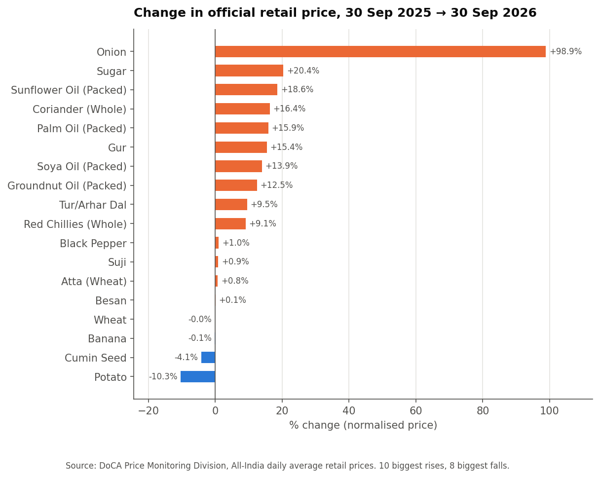
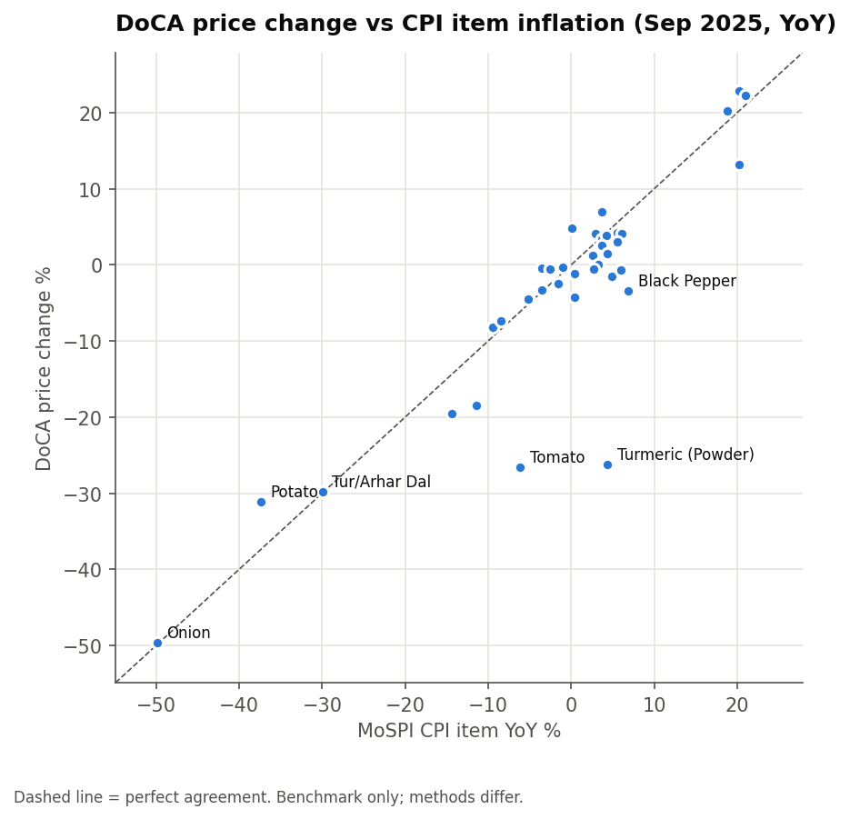

# Which Indian essentials are getting expensive — and does the official CPI agree?

**Indian Consumer Price & Market Intelligence System**: a repeatable pipeline that collects real
retail prices from open sources, standardises them to ₹ per kg / litre / unit, checks their quality,
stores them in a SQLite star schema and feeds a Power BI dashboard. It then compares my price changes
with MoSPI's official CPI.



## The answer so far (official DoCA All-India prices, 30 Sep 2026 vs a year earlier)

| | Change | What's really going on |
|---|---|---|
| **Onion** | **+99%** | A *recovery*, not a runaway: it is back almost exactly where it was two years ago (+0.1%) after a crash |
| **Sugar** | **+20%** | Even after falling 13% in the last month |
| **Edible oils** | **+8% to +19%** | The steady story: sunflower +19% in one year, **+46% over two years**; palm, soya, mustard and vanaspati all up |
| Tur dal | +9.5% | But still **−23%** vs two years ago |
| Potato | −10% | One of the few clear fallers |

Across 39 commodities, the average one-year change is **+7.8%** and the average one-month change is **+1.8%**.
Vegetables are by far the most volatile category, followed by sugar & gur and edible oils; cereals and dairy barely move.

## Does the official CPI agree? Mostly — with three clear exceptions



For 37 commodities matched to MoSPI CPI items (Sep 2024 → Sep 2025), **22 agree within 3 percentage points**
(onion −49.7% vs −49.9%, tur −29.8% vs −30.0%, mustard oil +22.2% vs +21.0%). They disagree on:

| Item | DoCA price change | CPI inflation | Likely reason |
|---|---|---|---|
| **Turmeric** | −26% | +4% | DoCA prices turmeric *powder* per 50 g; the CPI item is defined differently |
| **Tomato** | −27% | −6% | DoCA is one day's price; CPI averages the month, and tomato swings within a month |
| Black pepper | −3% | +7% | Same day-vs-month and item-definition effects |

CPI is an index, not a price, so it is kept in its own table and only ever shown **side by side** — never mixed into the price data.
**This project does not measure inflation.**

## Other findings

- **Discounts:** about 1 in 5 shop prices were discounted, by ~25% on average, mostly household, cleaning and staples; almost never chocolates, snacks or dairy.
- **Retail vs wholesale:** potato sells 35% above wholesale, tomato 27%, packed edible oils only ~5%.
- Full answers to all 8 questions: [`reports/FINDINGS.md`](reports/FINDINGS.md) and [`notebooks/05_price_analysis.ipynb`](notebooks/05_price_analysis.ipynb).

## Power BI dashboard

Seven pages: Overview, Product Trends, Brand Comparison, Location Comparison, Discount & Availability,
Data Quality, Price-Spike Monitor. Project file: `powerbi/ConsumerPrice_Dashboard/ConsumerPrice.pbip`.

<!-- screenshots: add reports/screenshots/p1_overview.png ... after opening the .pbip, then link them here -->

---

## Data sources — all openly published

| Source | What it gives | First snapshot (1 Oct 2026) |
|---|---|---|
| **DoCA Price Monitoring Division** public dashboard | Official All-India average retail (and wholesale) prices of 42 essentials, plus official values 1 week, 1 month, 6 months, 1 year and 2 years back | 275 price points |
| **Open Prices** (Open Food Facts) API | Shop-level prices of branded products: brand, pack size, discount, city, date | 402 records (390 in India) |
| **MoSPI CPI** API | Monthly CPI index, Jan 2024 – Dec 2025 (benchmark only) | 9,192 index values |

### What I deliberately did *not* use
- **DoCA's city-level (centre-wise) price reports.** They are behind a **CAPTCHA**. Bypassing a CAPTCHA is not acceptable, so they were not touched. That is why city comparison relies on crowd-sourced Open Prices and is the project's weakest area: only 6 products were seen in 2+ cities.
- **BigBasket, Blinkit, Zepto, JioMart, Amazon, Flipkart.** Their terms of service forbid automated scraping.
- **NHB city vegetable prices.** It's a public form, but the report kept hanging; a candidate to add later.

Full research log (URLs, access dates, extraction method, terms): [`docs/SOURCES.md`](docs/SOURCES.md).

## How it works

```
extract.py ─► data/raw/ (untouched, SHA-256 fingerprinted)
          ─► transform + normalize (pack size → ₹/kg, ₹/l, ₹/unit; brands, categories, cities, dates)
          ─► load.py (incremental: only new raw files) ─► SQLite star schema
          ─► quality.py (flags, never deletes) ─► analysis_queries.sql ─► Power BI CSVs
```

```
                dim_date ──┐            ┌── dim_brand
   dim_source ──┐          │            │
                ├── fact_price ─────────┼── dim_product
   dim_location ┘          │            └── dim_category
                └── fact_availability

   dim_cpi_item ── fact_cpi_benchmark     (kept separate: an index is not a price)
   dq_issue_log · dq_check_summary · etl_raw_file · fact_price_revision
```

**Data quality:** 27 checks. 30 of 677 price rows are excluded, each with a logged reason (duplicate
submissions, non-India shops, a "list price" of ₹99,99,999, a ₹1 typo against a ₹67 median, …).
Nothing is ever deleted. See [`notebooks/04_data_quality.ipynb`](notebooks/04_data_quality.ipynb).

## Project structure

```
├── run_pipeline.py            one command for the whole pipeline
├── scripts/                   run_daily.bat + setup_daily_task.bat (Windows Task Scheduler)
├── notebooks/                 01 collection → 02 cleaning → 03 database → 04 data quality → 05 analysis → 06 Power BI
├── src/                       extract, normalize, transform, load, quality, analysis, export_powerbi, viz
├── sql/                       schema.sql, analysis_queries.sql
├── data/raw/                  original downloads (first snapshot committed)
├── database/                  consumer_prices.db (generated, git-ignored)
├── reports/                   FINDINGS.md, figures/
├── powerbi/                   .pbip project, build guide, DAX measures, data/ (generated)
└── docs/                      SOURCES, METHODOLOGY_AND_LIMITATIONS, DATA_DICTIONARY, INTERVIEW_PREP
```

## Run it

```bash
pip install -r requirements.txt
python run_pipeline.py --rebuild       # build the database from the committed raw data
python run_pipeline.py --extract       # collect today's prices and append them
scripts\setup_daily_task.bat           # Windows: schedule the daily collection (11:00)
```

## Limitations

- **History is short.** The first snapshot holds 6 official dated points per commodity. The daily collection builds real day-by-day history, and the **price-spike monitor** (a daily change more than 2 standard deviations above that commodity's normal change) switches on once each commodity has 10+ daily steps.
- **City comparison is thin** (see "What I deliberately did not use").
- **"Availability"** means the source reported a price, not that the product was on the shelf.
- **Open Prices is crowd-sourced:** sparse and concentrated in a few cities.

Details: [`docs/METHODOLOGY_AND_LIMITATIONS.md`](docs/METHODOLOGY_AND_LIMITATIONS.md).
